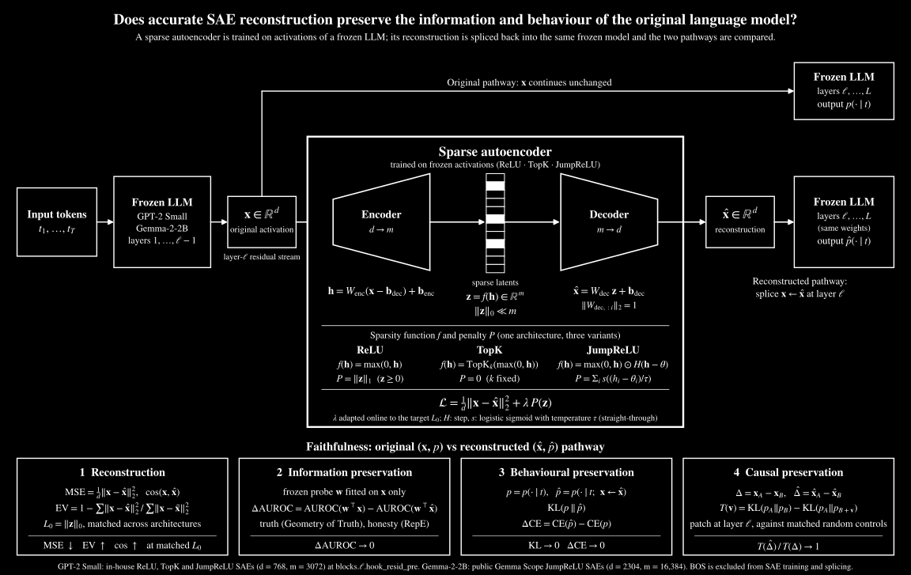

# SAE Faithfulness

**Does accurate sparse-autoencoder reconstruction preserve the information and behaviour of the original language model?**

GWU DATS 6501 Data Science Capstone, Fall 2026 · Aditi Shukla, Dhruv Rai, Simbanegavi Simbarashe

## What we do

A sparse autoencoder (SAE) rewrites a language model's dense internal activations as a sparse combination of learned
features, which interpretability work then reads as the model's "concepts". That reading is only safe if the SAE is
faithful to the model. We test this by training SAEs on the activations of a **frozen** LLM, splicing the
reconstruction back into the same model, and comparing the original and reconstructed pathways.



Faithfulness is measured at four separate levels. Good reconstruction is not assumed to imply the others.

| Level | Question | Measured by |
|---|---|---|
| Reconstruction | Is the reconstruction x̂ close to the activation x? | MSE, explained variance, cosine, at matched L0 |
| Information preservation | Can task information (truth, honesty) still be read from x̂? | AUROC gap of probes fitted on x only |
| Behavioural preservation | Does the model behave the same when x̂ replaces x? | Output KL, cross-entropy increase |
| Causal preservation | Does x̂ carry the causal effect the model uses for a task? | Activation patching against matched random controls |

**Setup**

* **Models (frozen):** GPT-2 Small (12 layers) and Gemma-2-2B (26 layers).
* **SAEs:** ReLU, TopK and JumpReLU, trained in-house on GPT-2 residual-stream activations; public Gemma Scope
  JumpReLU SAEs for Gemma-2-2B.
* **Data:** OpenWebText (SAE training, reconstruction, behaviour), Geometry of Truth (truth), RepE persona prompts
  (honesty), The Pile (Gemma).

## Repository structure

```
├── architecture/diagrams/   architecture diagram (.drawio, .svg) and the script that builds it
├── configs/                 dataset and run configuration
├── data/                    dataset files, splits and build notes (activation caches are not in Git)
├── scripts/                 experiment pipelines, numbered in run order
│   ├── openwebtext/         SAE training, reconstruction and splicing on OpenWebText
│   ├── geometry_of_truth/   truth probes and truth-preservation experiments
│   ├── repe/                honesty-persona task, causal site sweep and patch decomposition
│   ├── gemma/               Gemma-2-2B experiments
│   ├── cross_model/         GPT-2 vs Gemma comparisons
│   └── shared/              cross-dataset evaluation, splicing, CI and registry checks
├── src/                     shared library code
│   ├── sae/                 SAE models and checkpoint registry
│   ├── evaluation/          faithfulness metrics
│   ├── models/, data/, utils/
│   └── tests/               unit tests (python -m pytest -q src/tests)
├── results/                 outputs by dataset (openwebtext, geometry_of_truth, repe, gemma, gemma2_pile,
│                            cross_model, shared)
├── docs/                    methodology, research log, decisions, results registry
├── research_paper/          journal manuscript (LaTeX) and its figures
├── reports/                 course report and progress reports
├── presentation/            final presentation and slides
├── notebooks/, cookbooks/   exploratory notebooks
├── demo/                    demo notes and figures
├── aws/                     cloud setup notes
├── proposal.md              original project proposal
└── requirements.txt         Python dependencies
```

Model checkpoints and activation caches are not stored in Git; [`docs/checkpoint_registry.csv`](docs/checkpoint_registry.csv)
lists every checkpoint with its SHA-256. Start with [`docs/README.md`](docs/README.md) for the documentation map.

## Licence

[MIT](LICENSE)
